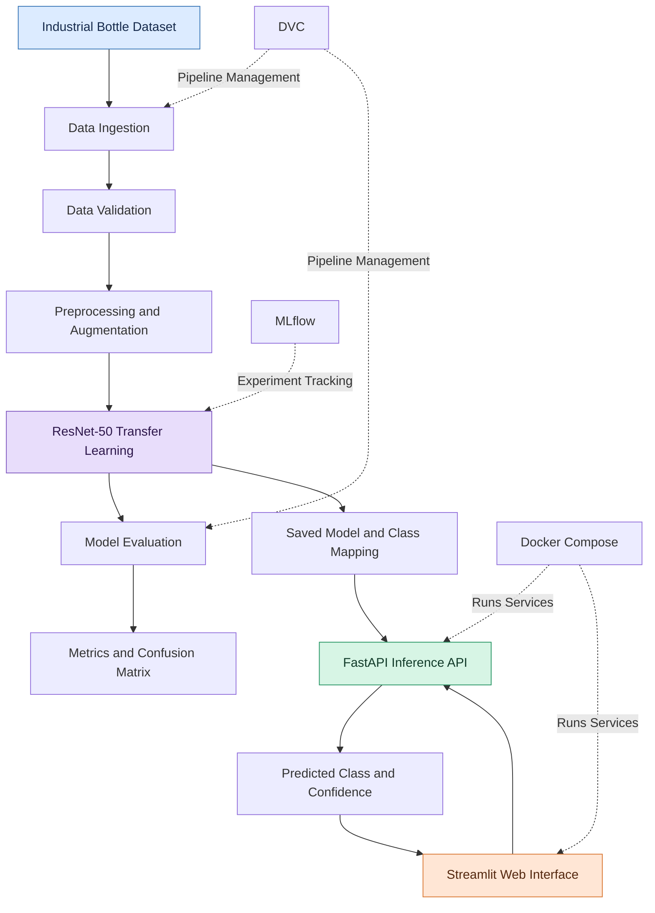
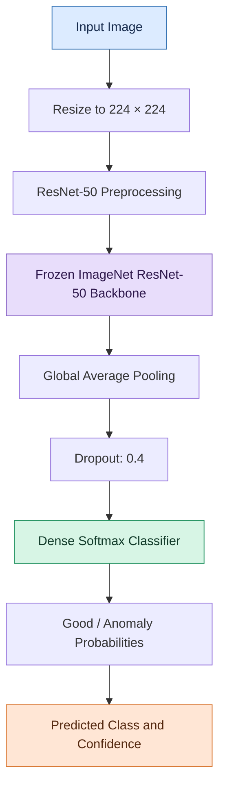
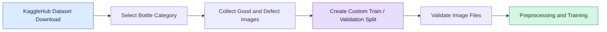
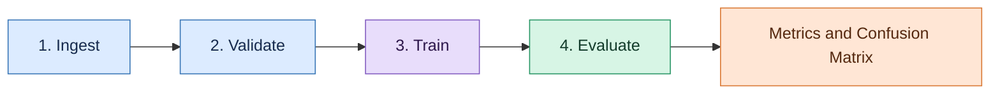

# 🏭 Industrial Fault Detection using ResNet-50 Transfer Learning & MLOps

<p align="center">
  <strong>An end-to-end computer vision project for industrial bottle defect classification.</strong>
</p>

<p align="center">
  
  
  
  
  
  
  
</p>

---

## 📌 Overview

Industrial quality inspection plays an important role in identifying potentially defective products before they reach customers. This project applies deep learning to classify industrial bottle images into two categories: **good** and **anomaly**.

The system uses **ResNet-50 transfer learning** with ImageNet pretrained weights and a custom classification head. It combines model training, evaluation, experiment tracking, data pipeline management, API-based inference, and an interactive web interface in one project.

### ✨ Key Features

- 🧠 **Deep Learning:** ResNet-50 transfer learning with a custom classification head.
- 🖼️ **Computer Vision:** Image resizing, ResNet-50 preprocessing, and training-time augmentation.
- ⚙️ **ML Pipeline:** Dataset ingestion, validation, training, and evaluation.
- 📊 **Experiment Tracking:** MLflow for recording training parameters, metrics, and model artifacts.
- 🔄 **Data Versioning:** DVC pipeline stages and artifact tracking.
- 🚀 **REST API:** FastAPI image prediction endpoint.
- 🖥️ **Interactive Dashboard:** Streamlit image upload and inspection interface.
- 🐳 **Containerization:** Docker and Docker Compose for the application services.

## 🏗️ System Architecture

The following diagram shows how data flows through the training pipeline and into the deployed inference application.



## 🧠 Model Workflow

The model uses a pretrained ResNet-50 backbone to extract image features. Its original top classification layers are excluded and replaced with a custom classification head for the two target classes.



**Important:** This project uses transfer learning. The ResNet-50 backbone is initialized with ImageNet pretrained weights and frozen during training; the custom classification head is trained for the selected dataset.

## 🛠️ Tech Stack

| Category | Technologies |
|---|---|
| Programming Language | Python |
| Deep Learning | TensorFlow, Keras |
| Model Architecture | ResNet-50 transfer learning |
| Data Processing | NumPy, Pandas |
| Image Processing | Pillow, TensorFlow |
| Evaluation | scikit-learn, Matplotlib, Seaborn |
| REST API | FastAPI, Uvicorn |
| Frontend | Streamlit |
| Experiment Tracking | MLflow |
| Pipeline Management | DVC |
| Containerization | Docker, Docker Compose |
| Dataset Download | KaggleHub |

## ⚙️ Training Configuration

The primary training settings are maintained in `params.yaml`.

| Parameter | Value |
|---|---|
| Dataset category | `bottle` |
| Input image size | `224 × 224` |
| Batch size | `8` |
| Maximum epochs | `15` |
| Learning rate | `0.001` |
| Dropout rate | `0.4` |
| Random seed | `42` |
| Pretrained weights | ImageNet |
| Backbone fine-tuning | Disabled |

Training includes class weighting, model checkpointing, early stopping, and learning-rate reduction on a plateau.

## 📂 Project Structure

```text
End-To-End-Industrial_Fault_Detection-using-Custom-ResNet-50-with-Mlops/
│
├── api/
│   └── main.py
│
├── ui/
│   └── streamlit_ui.py
│
├── src/
│   └── industrial_fault_detection/
│       ├── config.py
│       │
│       ├── data/
│       │   ├── data_ingestion.py
│       │   ├── data_validation.py
│       │   └── data_preprocessing.py
│       │
│       ├── model/
│       │   └── resnet_50.py
│       │
│       ├── training/
│       │   └── train.py
│       │
│       └── evaluation/
│           └── evaluate.py
│
├── tests/
│   └── test_api.py
│
├── params.yaml
├── dvc.yaml
├── docker-compose.yaml
├── Dockerfile
├── requirements.txt
├── pyproject.toml
└── README.md
```

Generated model and dataset files are excluded from ordinary Git tracking by the current `.gitignore`. They must be generated locally or retrieved through a configured DVC workflow before inference can run.

## 📦 Dataset

The project downloads the [MVTec Anomaly Detection (MVTec AD) dataset](https://www.mvtec.com/company/research/datasets/mvtec-ad) through KaggleHub using the dataset identifier `ipythonx/mvtec-ad`.

The current configuration focuses on the **bottle** category and organizes images into two classes:

| Class | Description |
|---|---|
| `good` | Images classified as non-defective |
| `anomaly` | Images classified as potentially defective |

### Dataset Preparation Workflow



**Dataset limitation:** The current ingestion code creates a custom supervised split and includes defect images from the original MVTec test folders. It does not preserve the official MVTec benchmark split. Results from this pipeline must not be described as official MVTec benchmark results.

## 🚀 Getting Started

### Prerequisites

- Git
- Python compatible with the project's TensorFlow dependencies
- pip
- Internet access for the initial dataset download
- Docker and Docker Compose for containerized execution

**Environment note:** The current `pyproject.toml` specifies Python 3.13, while the `Dockerfile` uses Python 3.11. Align these versions and verify dependency compatibility before setting up a clean environment.

### 1. Clone the Repository

```bash
git clone https://github.com/VENKATRAM027/End-To-End-Industrial_Fault_Detection-using-Custom-ResNet-50-with-Mlops.git
cd End-To-End-Industrial_Fault_Detection-using-Custom-ResNet-50-with-Mlops
```

### 2. Create a Virtual Environment

**Windows PowerShell**

```powershell
python -m venv .venv
.\.venv\Scripts\Activate.ps1
```

**Linux / macOS**

```bash
python -m venv .venv
source .venv/bin/activate
```

### 3. Install Dependencies

```bash
python -m pip install --upgrade pip
pip install -r requirements.txt
```

### 4. Configure the Source Path

The project packages are located under `src/`. Configure `PYTHONPATH` from the project root.

**Windows PowerShell**

```powershell
$env:PYTHONPATH = "$PWD\src"
```

**Linux / macOS**

```bash
export PYTHONPATH="$PWD/src"
```

Keep this environment variable configured in the terminal used to run the pipeline commands.

## 🔄 Run the DVC Pipeline

The complete pipeline is defined in `dvc.yaml`.

```bash
dvc repro
```

### Pipeline Stages



DVC manages the configured stages and their dependencies. For sharing datasets and model artifacts across machines, configure a DVC remote separately.

### Run Stages Individually

Run these commands from the project root after activating the environment and configuring `PYTHONPATH`.

**Dataset ingestion**

```bash
python -m industrial_fault_detection.data.data_ingestion
```

**Dataset validation**

```bash
python -m industrial_fault_detection.data.data_validation
```

**Model training**

```bash
python -m industrial_fault_detection.training.train
```

**Model evaluation**

```bash
python -m industrial_fault_detection.evaluation.evaluate
```

## 📊 Model Evaluation

The evaluation script currently generates:

- Accuracy
- Per-class precision, recall, F1-score, and support
- ROC-AUC when the required binary-class conditions are satisfied
- Confusion matrix

The generated artifacts are expected under `models/`:

```text
models/
├── bottle_best_model.keras
├── class_names.json
├── evaluation_metrics.json
└── confusion_matrix.png
```

The actual results depend on the model and data split. Run the evaluation pipeline to obtain the values; this README intentionally does not claim an unverified accuracy score.

**Evaluation limitation:** The current evaluation uses the validation dataset, which also contributes to checkpoint selection and early stopping. For a stronger final assessment, evaluate once on an independent held-out test set that was not used during model development.

## 📈 MLflow Experiment Tracking

MLflow records the configured training parameters, class weights, evaluation metrics, and model artifacts.

Start the MLflow UI from the project root:

```bash
mlflow ui --backend-store-uri ./mlruns --host 127.0.0.1 --port 5000
```

Open the dashboard:

**http://127.0.0.1:5000**

Use the interface to inspect recorded runs and their parameters and metrics.

## ⚡ Run the FastAPI Backend

Before launching the API, ensure that the trained model and `class_names.json` are available in the configured `models/` directory.

Start the server:

```bash
uvicorn api.main:app --reload --host 127.0.0.1 --port 8000
```

### API Endpoints

| Endpoint | Method | Purpose |
|---|---|---|
| `/` | GET | API welcome message |
| `/health` | GET | Check model loading status |
| `/predict` | POST | Classify an uploaded image |
| `/docs` | GET | Interactive Swagger documentation |

Open the API documentation:

**http://127.0.0.1:8000/docs**

The prediction endpoint accepts an image as multipart form data using the field name `file`. Its response contains the filename, predicted class, confidence, and raw class probabilities.

## 🖥️ Run the Streamlit Interface

Open a second terminal, activate the environment, and configure `PYTHONPATH` as described above.

Start the frontend:

```bash
streamlit run ui/streamlit_ui.py
```

Open the application:

**http://localhost:8501**

The dashboard supports image upload and displays the predicted class and confidence returned by the API. Start the FastAPI backend first and ensure the saved model is available.

## 🐳 Run with Docker Compose

Make sure the model and class mapping have been generated and are available in the local `models/` directory. The Compose configuration mounts that directory into the backend container.

Build and launch both services:

```bash
docker compose up --build
```

Access the services:

| Service | URL |
|---|---|
| Streamlit Dashboard | http://localhost:8501 |
| FastAPI Backend | http://localhost:8000 |
| API Documentation | http://localhost:8000/docs |

Stop the services:

```bash
docker compose down
```

The Docker environment and project dependency metadata should be aligned to a mutually compatible Python and TensorFlow setup.

## 🧪 Testing

A basic API test module is available at `tests/test_api.py`.

Install test dependencies if necessary:

```bash
pip install pytest httpx
```

Run the tests:

```bash
python -m pytest
```

The existing tests expect the FastAPI application to load the saved model during startup. Ensure the model artifacts are present before running them.

## ⚠️ Current Scope and Limitations

This project is an applied machine learning prototype rather than a validated industrial inspection product.

- It performs **image-level binary classification**; it does not draw bounding boxes or generate defect segmentation masks.
- The current pipeline uses a custom dataset split rather than the official MVTec benchmark split.
- The current evaluation is validation-based; independent test-set performance has not been established here.
- Predictions and confidence scores require further validation on representative real-world manufacturing images.
- Dependency versions and artifact availability should be verified for clean, reproducible setup.

## 🔮 Potential Improvements

- Independent held-out test-set evaluation.
- More complete API and model-loading tests.
- Dependency pinning and a verified reproducible environment.
- Consistent probability responses between the API and Streamlit interface.
- Configured DVC remote for sharing tracked data and artifacts.
- Automated testing and code-quality checks through CI.
- Experiments with additional product categories and anomaly-detection approaches.
- Defect localization or segmentation for spatially identifying defects.

## 👨‍💻 Author

**Venkatram**

- GitHub: [@VENKATRAM027](https://github.com/VENKATRAM027)
- Project Repository: [End-To-End Industrial Fault Detection](https://github.com/VENKATRAM027/End-To-End-Industrial_Fault_Detection-using-Custom-ResNet-50-with-Mlops)

## 📄 License

Add a `LICENSE` file to the repository and update this section with the license you choose before distributing the project for reuse.

---

<p align="center">
  <strong>Built to explore computer vision, applied machine learning, and end-to-end ML engineering.</strong>
</p>